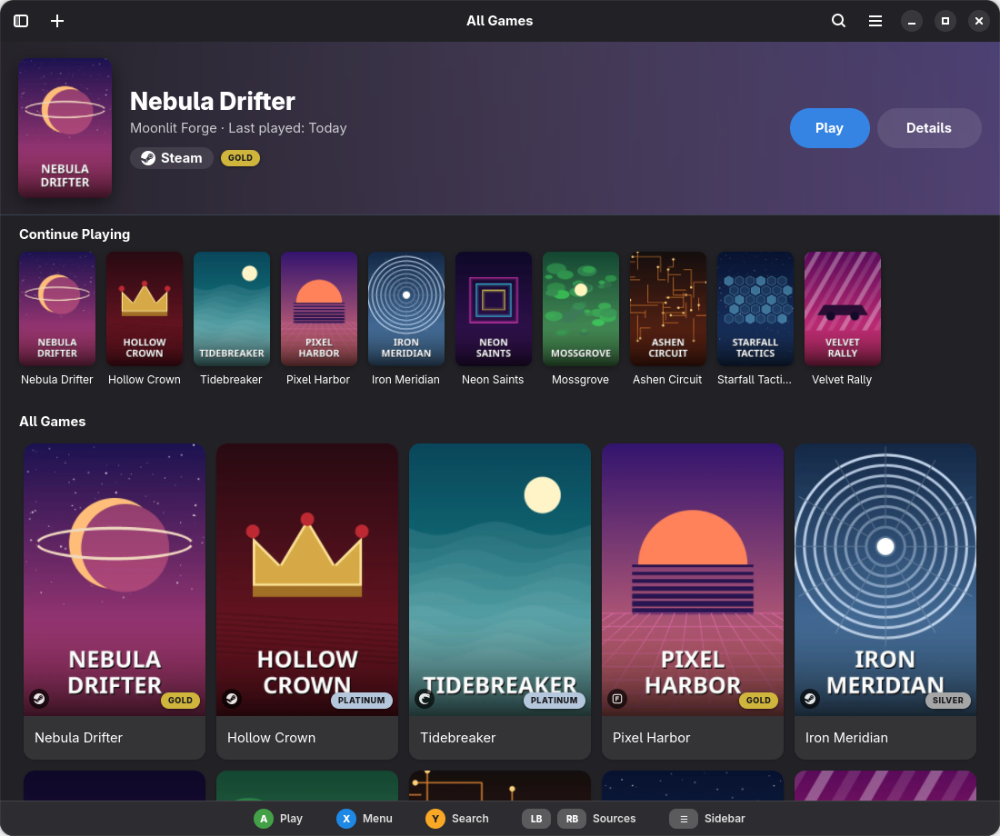

[circle-url]: https://circle.gnome.org
[circle-image]: https://circle.gnome.org/assets/button/badge.svg
[weblate-url]: https://hosted.weblate.org/engage/cartridges/
[weblate-image]: https://hosted.weblate.org/widgets/cartridges/-/cartridges/svg-badge.svg
[discord-url]: https://discord.gg/yrJfddyt56
[discord-image]: https://img.shields.io/discord/1088155799299313754?color=%235865F2&label=discord&logo=discord&logoColor=%23FFFFFF&style=for-the-badge
[flathub-url]: https://flathub.org/apps/page.kramo.Cartridges
[flathub-image]: https://img.shields.io/flathub/v/page.kramo.Cartridges?logo=flathub&style=for-the-badge
[installs-image]: https://img.shields.io/flathub/downloads/page.kramo.Cartridges?style=for-the-badge

> [!IMPORTANT]
> This project is no longer actively maintained.
> The `rewrite` branch has the most up-to-date code in case someone wants to keep it alive through a fork, but be aware that not everything there is functional. Still, please don't use code from the `main` branch as it's of poor quality.

  

  # Cartridges

  A GTK4 + Libadwaita game launcher

  [![GNOME Circle][circle-image]][circle-url]
  [![Translation Status][weblate-image]][weblate-url]

  [![Flathub][flathub-image]][flathub-url]
  [![Discord][discord-image]][discord-url]
  [![Installs][installs-image]][flathub-url]

  

# The Project

Cartridges is an easy-to-use, elegant game launcher written in Python using GTK4 and Libadwaita.

## Features

- Manually adding and editing games
- Importing games from various sources (only games: launchers like Steam or Heroic, tools like Proton, Goverlay or ProtonUp-Qt, and emulators are skipped):
  - Steam
  - Lutris
  - Faugus Launcher
  - Heroic
  - Bottles
  - itch
  - Legendary
  - RetroArch
  - Flatpak
  - Desktop Entries
- Filtering games by source
- A badge on each cover with the platform the game came from (Steam, Epic, GOG, Amazon, Lutris, Faugus...); clicking it opens that app (the page of the game on Steam). The game menu has "Open Steam" (or the right app) too
- Searching and sorting by title, date added and last played
- Hiding games
- Automatically downloading cover art from [SteamGridDB](https://www.steamgriddb.com/)
- ProtonDB ratings (Platinum, Gold, Silver, Bronze, Borked) on each cover and on the details page, for Steam games and for games of the other platforms whose title matches a Steam game exactly. Ratings are cached for a week and can be turned off in the preferences (the Steam ID or the title of each game is sent to Steam and ProtonDB)
- Searching for games on various databases
- Animated covers
- A search provider for GNOME
- Navigating with an Xbox or PlayStation controller

## Controller support

Xbox and PlayStation controllers (wired or Bluetooth) can navigate the whole app through [libmanette](https://gnome.pages.gitlab.gnome.org/libmanette/). The buttons are named by position, so the same layout works on both:

| Xbox | PlayStation | Action |
|---|---|---|
| D-pad or left stick | D-pad or left stick | Move the focus (hold to repeat) |
| A | ✕ | Launch the game, or press the focused button |
| B | ○ | Close the menu or dialog, leave the search, go back |
| X | □ | Open the menu of the focused game (Details, Edit, Hide, Remove, Open the app it came from) |
| Y | △ | Search |
| LB / RB | L1 / R1 | Previous / next source in the sidebar |
| Menu | Options | Show or hide the sidebar |

The controller only works while the app window has the focus, so it never reacts while you are playing. If libmanette is not installed, the app works as before. The Flatpak needs `--device=input` to see controllers.

To try it without a controller, `tests/gamepad_uinput.py` creates virtual Xbox and DualSense controllers (see the file for how to run it).

For updates and questions, join our [Discord server][discord-url]!

## Donations
I accept donations through [GitHub Sponsors](https://github.com/sponsors/kra-mo) and [Liberapay](https://liberapay.com/kramo).

Thank you for your generosity! 💜

# Installation

## Linux

The app is available on Flathub.

## Windows

### From Releases

1. Download the latest release from [GitHub Releases](https://github.com/kra-mo/cartridges/releases).
2. Run the downloaded installer.

Note: Windows might present you with a warning when trying to install the app. This is expected, just ignore the warning.

### Winget

Install the latest release with the command: `winget install cartridges`.

## macOS

1. Download the latest release from [GitHub Releases](https://github.com/kra-mo/cartridges/releases).
2. Move the app into your Applications folder.

Note: macOS might tell you that the application could not be checked for malicious software or something similar. In this case, open System Settings > Privacy & Security, scroll down, find the warning about Cartridges and click "Open Anyway". More information can be found [here](https://support.apple.com/en-us/102445).

## Building manually

See [Building](https://codeberg.org/kramo/cartridges/src/branch/main/CONTRIBUTING.md#building).

# Contributing

See [CONTRIBUTING.md](https://codeberg.org/kramo/cartridges/src/branch/main/CONTRIBUTING.md).

Thanks to [Weblate](https://weblate.org/) for hosting our translations!

# Code of Conduct

The project follows the [GNOME Code of Conduct](https://conduct.gnome.org/). 

Cartridges' contributors stand with Palestine, Ukraine and all other victims of imperialism and war, and believe trans rights are human rights. If this bothers you, this is probably not the best project for you to contribute to.

See [CODE_OF_CONDUCT.md](https://codeberg.org/kramo/cartridges/src/branch/main/CODE_OF_CONDUCT.md).
